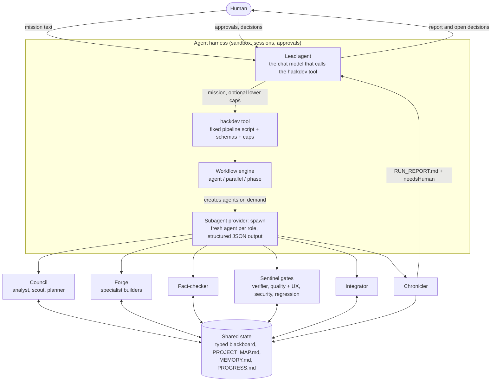
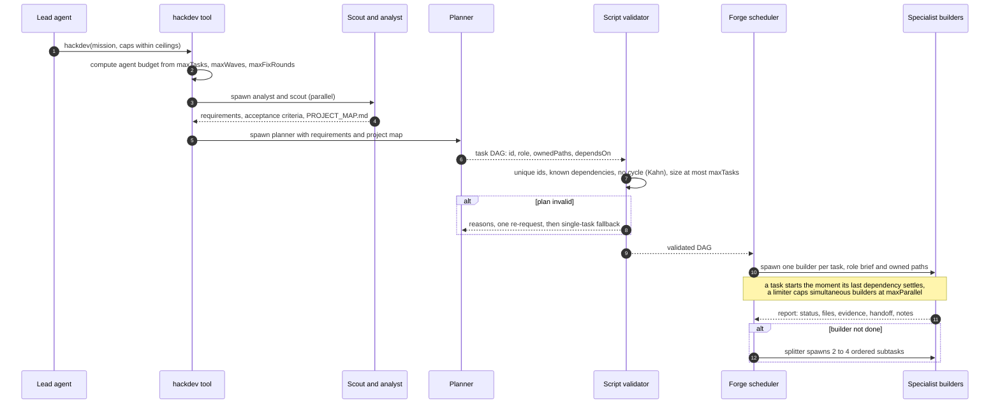
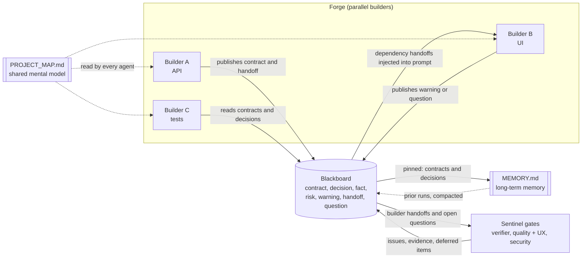
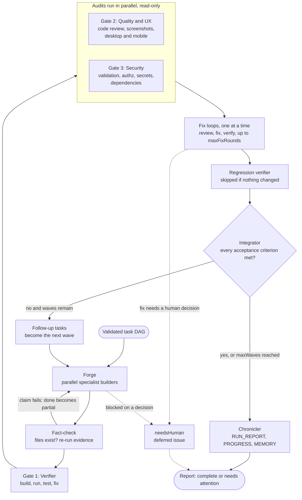

# Hack Dev Code

**An autonomous AI engineering guild.** You give it a mission. It maps the project, sizes a team of specialist agents to the work, builds in parallel waves over a shared blackboard, fact-checks every claim, and then proves the result through three independent gates: a verifier, a quality and UI/UX reviewer that looks at real screenshots, and a security reviewer. It keeps iterating until every acceptance criterion is met, and it stops and asks a human whenever a decision is not its to make.

> Built for hackathon problem statement **PS-001: DevPilot, the Mystic Mikado's Autonomous AI Engineering Guild**.
> *Plan like a Shogun. Build like a Samurai. Test like a Sentinel. Adapt until the mission is complete.*

Hack Dev Code is a multi-agent layer on top of an existing, production-grade agent harness (sandboxed tools, sessions, subagents, a Web UI and a CLI). The harness is the runtime; the guild in [`packages/hackdev`](packages/hackdev) is the product built for this problem statement.

---

## Contents

1. [How it answers the problem statement](#how-it-answers-the-problem-statement)
2. [Architecture](#architecture)
3. [Agent responsibilities](#agent-responsibilities)
4. [Setup and run](#setup-and-run)
5. [Configuration](#configuration)
6. [Available tools and execution boundaries](#available-tools-and-execution-boundaries)
7. [Human oversight and approval workflow](#human-oversight-and-approval-workflow)
8. [Memory and agent communication](#memory-and-agent-communication)
9. [Security](#security)
10. [Evaluation scenarios](#evaluation-scenarios)
11. [Deliverables checklist](#deliverables-checklist)
12. [Bonus points](#bonus-points)
13. [Known limitations](#known-limitations)
14. [Repository layout, tests and license](#repository-layout-tests-and-license)

---

## How it answers the problem statement

| PS-001 requirement | What Hack Dev Code does | Where |
|---|---|---|
| **A. Planning**: requirement analysis, codebase reconnaissance, task decomposition, shared mental model | An analyst turns the mission into requirements and acceptance criteria; a scout inspects the workspace and writes a project map; a planner returns a dependency graph of small tasks, validated with a topological sort. Every agent receives the same map and plan. | [`script.ts`](packages/hackdev/tool-hackdev/src/script.ts), `.hackdev/PROJECT_MAP.md` |
| **B. Implementation**: tool selection, context-aware development, adaptive problem solving, controlled execution | One specialist builder per task (frontend, backend, data, test, docs, security...), running in parallel as dependencies allow. A builder that fails is split into ordered subtasks instead of retried blindly. Builders work only inside their owned paths and the workspace sandbox. | Forge phase |
| **C. Testing and verification**: automated tests, failure investigation, independent verification | Gate 1 builds, runs, tests and fixes. It treats a result as passed only with evidence. The gates are separate agents from the builders, so nobody grades their own work. | Sentinel Gates |
| **D. Review and security**: evidence-based completion, code review, security scanning, cross-agent critique, human oversight | Gate 2 reviews quality and visually tests the UI; Gate 3 audits and hardens security. A fact-checker re-runs claimed evidence. Decisions that need a person are listed in `needsHuman` at the top of every report. | Gates, fact-check, report |
| **E. Coordination and adaptive autonomy**: inter-agent communication, feedback loops, adaptive orchestration, bounded autonomy | A typed blackboard, handoff notes, waves that open follow-up tasks for unmet criteria, review-fix loops with hard caps, and a fixed agent budget. | Waves, blackboard |
| **Technical requirements**: an existing agent framework, existing tools, a local model, GitHub is not a prerequisite | Runs on a real agent harness with its sandboxed tools and a DeepSeek model through an API key. Everything runs locally; there is no hosted backend. | `apps/`, `packages/` |
| **Evaluation scenarios** | See [Evaluation scenarios](#evaluation-scenarios) for how to run each one. | below |

---

## Architecture

The pipeline script, schemas and gate order are fixed in code. The model that calls the tool only supplies the mission text and numeric caps inside deployment ceilings, so the orchestration is repeatable and cannot be talked out of its checks. For the full design (failure table, scope discipline, visual verification protocol, Web UI) read [`docs/hack-dev-code.md`](docs/hack-dev-code.md).

### 1. System overview



### 2. How the lead agent generates the agent team

The lead never hand-picks agents. It calls one tool; the pipeline builds the team from the mission.



**Team sizing.** The planner is told to size the team to the mission: one or two tasks for a trivial change, three to six for a small app, six to fourteen for a medium product, up to `maxTasks` for a large system. Each task carries a **role** (frontend, backend, fullstack, data, api, infra, test, docs, design, security), so each builder gets a matching specialist brief and only owns its own paths.

**Dynamic creation.** Agents are created while the run progresses, not up front: builders per task, a **splitter** when a builder fails to finish, extra tasks from the **integrator** when a wave leaves criteria unmet. A hard agent budget derived from the caps stops runaway spawning.

### 3. Agent-to-agent communication

There is no free-form chat. Agents talk through typed, validated records, and every message is stored.



| Channel | Used for | Rule |
|---|---|---|
| Structured report | Every agent returns JSON checked against a schema, then re-validated by the script | Invalid output is a failed agent, not silently accepted |
| Blackboard note | `contract`, `decision`, `fact`, `risk`, `warning`, `handoff`, `question` | Duplicates dropped; contracts and decisions are pinned and always reach the prompt |
| Handoff | A builder's public interfaces, locations, how to run and test, caveats | A dependent builder receives each dependency's handoff; gates receive all of them |
| Workspace files | `PROJECT_MAP.md`, `MEMORY.md`, `PROGRESS.md` | Read by every agent; MEMORY is deduplicated and compacted within `maxMemoryChars` |
| Ownership | Disjoint `ownedPaths` per builder | A cross-boundary edit must be published as a `warning` |

### 4. Waves, gates and the feedback loop



A run is `complete` only when every task is done, every gate passes and every acceptance criterion is met. Anything that needs a person is surfaced at the top of the report instead of being decided silently.

---

## Agent responsibilities

| Agent | Phase | Responsibility | Output |
|---|---|---|---|
| **Requirements analyst** | Council | Turns the mission into requirements and testable acceptance criteria. | Requirement list |
| **Codebase scout** | Council | Inspects the workspace: stack and versions, entry points, verified commands, conventions, key files, risks, prior progress. | `PROJECT_MAP.md` |
| **Planner** | Council | Sizes the team to the mission and returns small tasks with dependencies, owned paths and specialist roles. | Validated task DAG |
| **Specialist builders** | Forge | One per task. Implement and test inside owned paths; publish contracts, decisions, warnings and a handoff note. | Code, tests, handoff |
| **Splitter** | Forge | When a builder does not finish, splits the remaining work into two to four ordered subtasks. | Subtasks |
| **Fact-checker** | After each Forge | Checks that listed files exist and re-runs the cheapest decisive evidence. | Downgrades false claims |
| **Verifier (gate 1)** | Sentinel | Builds, runs and tests for syntax, logic and runtime errors; fixes them; investigates failures. | Pass or fail with evidence |
| **Quality + UX reviewer (gate 2)** | Sentinel | Reviews code quality; starts the UI, takes desktop and mobile screenshots, looks at them, exercises the main flows, fixes defects. | Issues, `uiEvidence` |
| **Security reviewer (gate 3)** | Sentinel | Audits validation, escaping, authorization, headers, secrets, dependencies; hardens and adds regression tests. | Issues fixed or deferred |
| **Regression verifier** | Sentinel | Re-runs the verifier after the audits changed code. Skipped when nothing changed. | Final verdict |
| **Integrator** | End of each wave | Judges every acceptance criterion against evidence and opens follow-up tasks for unmet ones. | `PROGRESS.md` |
| **Chronicler** | End of run | Writes the run report and compacts long-term memory. | `RUN_REPORT.md`, `MEMORY.md` |

---

## Setup and run

**Requirements:** Node.js 24.9 or newer, pnpm 11, and a DeepSeek API key. Windows, macOS and Linux are supported.

```sh
pnpm install
pnpm run build:artifacts
```

The build computes a version/commit stamp from git. If the folder is not a git checkout, set one yourself first:
`DSH_CLIENT_COMMIT_HASH=abcdef1` (PowerShell: `$env:DSH_CLIENT_COMMIT_HASH = 'abcdef1'`).

**Provide the API key** through the environment. It is never written to the repository, prompts or reports.

```sh
export DEEPSEEK_API_KEY=...          # PowerShell: $env:DEEPSEEK_API_KEY = "..."
```

You can also open **Settings → Models** in the Web UI and paste the key there.

**Run the Web UI** (live phases, agents and gate results):

```sh
pnpm run start:web                   # prints http://127.0.0.1:3080/?token=...
```

Open the printed address, choose or add a workspace folder, and send a mission such as
*"Use hackdev to build a single-file tip calculator with tests."* The chat shows the live workflow (Council, Forge, Fact-check, Sentinel Gates, Integrator) and then a **Hack Dev Code mission** card with the status, task results, gate verdicts and everything that needs your attention.

**Run one mission headless** (no server, prints the report):

```sh
node apps/cli/lib/bin.js --profile headless "Use hackdev to <your mission>"
```

**Review work done elsewhere** with only the three gates:

```sh
node apps/cli/lib/bin.js --profile headless "Use hackdev_review to review this repository"
```

Everything an agent produces lives in the workspace under `.hackdev/` (`PROJECT_MAP.md`, `PROGRESS.md`, `MEMORY.md`, `RUN_REPORT.md`, `screenshots/`).

---

## Configuration

The pipeline is configured on the `tool-hackdev` row of [`packages/bundle/base/cordis.patch.yml`](packages/bundle/base/cordis.patch.yml) (the Web presets in `packages/bundle/web-app/presets/` carry the same values).

| Option | Default | Meaning |
|---|---|---|
| `subagentProvider` | `spawn` | Provider that creates a fresh structured-output agent for each pipeline role |
| `maxTasks` | 24 | Ceiling on tasks planned per wave |
| `maxParallel` | 6 | Builders running at the same time |
| `maxWaves` | 3 | Ceiling on build waves (follow-up waves for unmet criteria) |
| `maxFixRounds` | 2 | Extra review-fix rounds per gate |
| `maxMemoryChars` | 6000 | Blackboard text injected into one prompt, and the compaction target for `MEMORY.md` |
| `maxResultChars` | 16384 | Size of the report returned to the calling model |
| `visionModel` | empty | Optional image-capable model for the UI gate; empty inherits the default route |

A call to `hackdev` may lower `maxTasks`, `maxWaves` and `maxFixRounds`, never raise them above these ceilings. The total number of agents is capped by a computed budget (`maxTasks`, `maxFixRounds` and `maxWaves` together), so a run cannot spawn without bound. Lower the caps for quick demos.

---

## Available tools and execution boundaries

| Tool | Use |
|---|---|
| `hackdev` | Run the whole pipeline for a mission: Council, waves of Forge and Gates, Chronicle. |
| `hackdev_review` | Run only the three gates on the current workspace, for work done outside the pipeline. |

Agents also use the harness tools that already exist: file read, write and edit, search, shell commands (PowerShell or Bash), image reading for screenshots, structured user questions, MCP resources and optional browser tools. The generated reference of every tool, its arguments and result shape is in [`docs/tool-catalog.md`](docs/tool-catalog.md); every setting is in [`docs/config-catalog.md`](docs/config-catalog.md).

**Boundaries that always apply:**

- **Workspace only.** Agents work inside the chosen workspace. The default permission mode is *Workspace Write*; reads and writes outside it need approval.
- **Sandboxed execution.** Shell commands run under the harness sandbox and approval policy.
- **Owned paths.** Parallel builders each own disjoint paths. Editing across the boundary has to be published as a warning on the blackboard.
- **No destructive or irreversible actions** (deleting data, force operations, external side effects) without a human decision.
- **No secrets** in code, logs, prompts or reports.
- **Hard caps** on tasks, parallelism, waves, fix rounds, memory size and total agent count.
- **Cancellation.** Cancelling the parent turn cancels the run and all its children.

---

## Human oversight and approval workflow

1. Every report opens with **Needs attention**: unfinished tasks, open issues, decisions deferred to a person, and anything that requires approval.
2. A builder that is blocked on a human decision is *not* retried: it is surfaced in `needsHuman`.
3. A gate that would have to grow the project (adding authentication, TLS, a database) does not do it silently. It records a `deferred` issue with a precise remediation and asks for your approval.
4. A run is `complete` only when every task is done, every gate passes and every acceptance criterion is met. Otherwise it reports **needs attention**, with the evidence for each item.
5. In the Web UI the same list is the first section of the mission card, and the agent can ask structured questions mid-run.
6. The sandbox's own approval prompts (for example, writing outside the workspace) stay in force for every agent.

---

## Memory and agent communication

There is no free-form chat between agents. Communication is explicit, typed and auditable.

- **Structured reports.** Builders, gates, the fact-checker and the integrator return JSON checked against a schema.
- **Typed blackboard.** Notes of kind `contract`, `decision`, `fact`, `risk`, `warning`, `handoff` and `question`. Duplicates are dropped; contracts and decisions are pinned so they always reach the prompt.
- **Handoff notes.** A dependent builder receives each dependency's summary, files and handoff; the gates receive every builder's handoff and open questions.
- **Project map** (`.hackdev/PROJECT_MAP.md`): the shared mental model injected into every agent.
- **Long-term memory** (`.hackdev/MEMORY.md`): persists across runs, deduplicated and compacted within `maxMemoryChars`.
- **Progress ledger** (`.hackdev/PROGRESS.md`): a rerun in the same workspace plans only the remaining work.

### Preventing hallucination

- Prompts require reading a file before editing, citing paths, and never inventing APIs, packages, flags or results.
- A task that reports `done` without evidence is downgraded to `partial`.
- The fact-checker verifies listed files exist and re-runs claimed evidence; claims that do not reproduce downgrade the task.
- A gate `pass` is accepted only with at least one passing check, no failing check and no open issue. `uiVerified` is rejected without viewed-screenshot evidence.

---

## Security

- The platform enforces sandboxing, approvals and bounded autonomy (see above).
- The **security reviewer** gate audits and hardens whatever the guild builds: input validation, output escaping, authorization checks, security headers, rate limits, secret handling and dependency audit, and it adds regression tests for what it fixes.
- No process can guarantee that software "cannot be hacked". The report therefore lists what was checked, what was fixed, and what remains open or deferred.
- The API key is read from `DEEPSEEK_API_KEY` or the app's credential store. Never commit it.

---

## Evaluation scenarios

| Scenario | How to exercise it |
|---|---|
| **Feature implementation** | `hackdev` with "add X to this repository" in an existing project. |
| **Bug fix** | `hackdev` with a failing test or reproduction steps in the mission. |
| **Test-driven recovery** | State in the mission that tests are red. The verifier loops until they are green or reports what stays open. |
| **Security and code review** | `hackdev_review` on an existing repository: it reviews, finds weaknesses, fixes what is in scope and defers the rest. |
| **Unexpected condition** | Break a build or remove a dependency mid-run. A failed builder is split into subtasks, a failed dependency makes dependents `skipped`, and a crashed gate is recorded as a failed gate. |
| **Long-horizon build** | A large mission. The planner sizes a bigger team and the integrator opens follow-up waves until the criteria are met. |
| **Resume after interruption** | Run again in the same workspace. The scout reads `.hackdev/PROGRESS.md` and only remaining work is planned. |

Each run ends with `.hackdev/RUN_REPORT.md`: what the agents did, the decisions they made, the evidence for each result and the items awaiting a human.

---

## Deliverables checklist

| Deliverable | Status |
|---|---|
| Source code and a working demonstration | This repository; the Web UI and CLI run a full mission end to end. |
| Multi-agent planning, implementation and verification workflow | `packages/hackdev/tool-hackdev` |
| Testing, verification, review and a feedback loop | Three gates with bounded review-fix loops, fact-check, regression pass |
| At least one mission ending in a working result | Demonstrated with a tip calculator (headless and Web), a notes app (70/70 checks) and a gates-only review that found a real DNS-rebinding weakness |
| Setup instructions and configuration | [Setup and run](#setup-and-run), [Configuration](#configuration) |
| Architecture diagram and agent responsibilities | [Architecture](#architecture), [Agent responsibilities](#agent-responsibilities) |
| Available tools and execution boundaries | [Available tools and execution boundaries](#available-tools-and-execution-boundaries) |
| Human oversight and approval workflow | [Human oversight and approval workflow](#human-oversight-and-approval-workflow) |
| Known limitations | [Known limitations](#known-limitations) |

---

## Bonus points

- **Parallel and dynamic agent creation.** The team is sized to the mission and builders run in parallel. Failed tasks spawn subtasks on demand.
- **Automatic review and recovery.** Verifier, quality, security and regression gates with bounded review-fix loops, plus a fact-checker.
- **Persistent memory.** A shared blackboard, a project map, long-term memory and a progress ledger make runs resumable.
- **Evidence-based reporting.** Every verdict carries checks and evidence; unproven claims are downgraded.
- **Live visibility.** The Web UI shows live phases and agents and a final result card with the attention list.
- **Visual verification.** The UI gate takes real screenshots at desktop and mobile widths and judges them.

---

## Known limitations

- Quality depends on the underlying model. The gates add evidence and loops, not guarantees.
- Visual verification needs a headless browser, the project's own Playwright, or a mounted browser provider, plus an image-capable model route. Without them the report says the UI was not visually exercised.
- Parallel builders share one working directory. Disjoint owned paths make collisions unlikely, not impossible; the quality and security audits run read-only for that reason.
- The blackboard is bounded: older, non-pinned entries drop out of prompts (they stay in `MEMORY.md` until compacted).
- The fact-checker re-runs at most eight commands per wave, so it samples evidence rather than repeating everything.
- Some repository tests need a POSIX environment (symlinks, git) and fail on Windows for that reason alone.

---

## Repository layout, tests and license

```text
packages/hackdev/tool-hackdev        mission pipeline plugin (src/script.ts holds the fixed scripts)
packages/hackdev/client-ui-hackdev   Web card for mission and gate-review results
packages/core/system-prompt          prompt sections for the pipeline policy
packages/bundle/                     product bundles (base, web-app, headless) that mount the tools
packages/*/ , vendor/                the agent harness: sessions, tools, sandbox, UI, LLM adapters
apps/cli, apps/web, apps/desktop     command line, Web UI and desktop shell
docs/                                design doc and generated tool and config references
```

```sh
pnpm vitest run packages/hackdev     # orchestration logic, deterministic, no network
pnpm run typecheck
pnpm run lint
```

The orchestration tests run the real pipeline scripts in a Node VM with scripted agents, so DAG scheduling, retries, memory sharing and gate verdicts are verified without a model.

Repository conventions for contributors are in [AGENTS.md](AGENTS.md).

[MIT](LICENSE). Third-party dependencies and their licenses are listed in [THIRD_PARTY_NOTICES.md](THIRD_PARTY_NOTICES.md).
