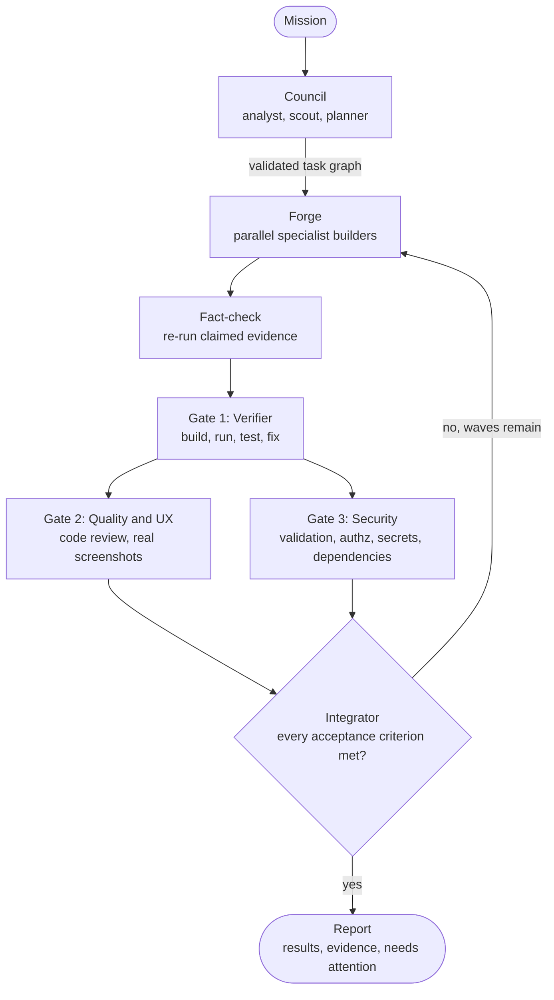

# Hack Dev Code

**An AI agent that works on your computer the way a person does.** It writes and fixes code, runs whole projects with a team of specialist agents, and operates the desktop and the browser: it opens apps, reads windows, clicks, types and checks its own work. It runs on the model you choose: local Ollama models that never leave your machine, DeepSeek, or any OpenAI-compatible provider.

Hack Dev Code ships as a desktop app for Windows and macOS, a Web UI, a command line for Windows, macOS and Linux, a VS Code extension and a GitHub Action for pull-request review. Everything runs on your machine; there is no hosted backend and no account to create.

---

## Contents

1. [What it does](#what-it-does)
2. [Install](#install)
3. [Quick start](#quick-start)
4. [Models and keys](#models-and-keys)
5. [Desktop and browser control](#desktop-and-browser-control)
6. [Multi-agent missions](#multi-agent-missions)
7. [Permissions and safety](#permissions-and-safety)
8. [Customize: skills, connectors, MCP and plugins](#customize-skills-connectors-mcp-and-plugins)
9. [Integrations](#integrations)
10. [Configuration](#configuration)
11. [Architecture](#architecture)
12. [Build from source](#build-from-source)
13. [Known limitations](#known-limitations)
14. [Contributing, license and acknowledgements](#contributing-license-and-acknowledgements)

---

## What it does

| Area | Capability |
|---|---|
| **Coding** | Reads, writes and edits files, runs shell commands (PowerShell or Bash), searches with `glob`, `grep` and a ranked `code_search` over definitions, and keeps a to-do list that it finishes before it reports back. |
| **Missions** | The `hackdev` tool turns one request into a planned project: an analyst, a scout and a planner size a team, specialist builders work in parallel, and three independent gates verify, review (including real screenshots of the UI) and secure the result. |
undefined
| **Desktop control** | Launches apps by name, lists and reads windows through UI Automation (Windows) or AT-SPI (Linux), acts on numbered controls, reads text with OCR, clicks, drags, scrolls, types and presses shortcuts with real input, across every monitor. |
| **Browser** | A built-in browser pane in the desktop app, plus agent control of Chrome through Chrome DevTools, with a persistent profile so sign-ins stay. |
| **Models** | Local models through Ollama, listed straight from your Ollama install; DeepSeek and any OpenAI-compatible provider through an API key. No account or sign-in. Add several keys per provider and requests rotate through them. |
| **Extensibility** | **Settings → Customize** with skills, connectors and MCP servers, a plugin marketplace on the Plugins page, custom instructions and `AGENTS.md` files. The agent can delegate to subagents and run workflows. |
| **Everywhere you work** | Desktop app, Web UI, CLI, VS Code extension and a GitHub Action. |

The agent runtime is the upstream DeepSeek Harness: the same agent loop, subagents and workflow engine, with desktop control, local models and the Customize area added on top.

---

## Install

### Desktop app (Windows)

Download the latest installer from the [Releases](https://github.com/raghubirmahato/Hack-Dev-Code/releases) page and run it. It installs for the current user and adds the `hackdev` command to your terminal. The app updates itself from GitHub Releases.

- The installer is not code-signed yet, so Windows SmartScreen may ask you to confirm. Choose **More info → Run anyway**.
- The app asks for administrator rights when it starts, so the agent can install software and operate apps that run as administrator. Decline and it keeps running with normal rights. To never ask, set `HACKDEV_RUN_AS_ADMIN=0` or start it with `--no-admin`.
- If Hack Dev Code is running when you install, update or uninstall, the installer offers to close it for you.

### macOS and Linux

Build the desktop app for macOS, or use the Web UI and CLI on any platform, from source: see [Build from source](#build-from-source).

On Linux, desktop control needs X11 tools:

```sh
sudo apt-get install -y x11-xserver-utils xdotool imagemagick wmctrl xdg-utils xclip tesseract-ocr
```

In a Wayland session it uses ydotool, the compositor's screenshot tool and wl-clipboard instead:

```sh
sudo apt-get install -y ydotool wl-clipboard grim imagemagick tesseract-ocr
sudo systemctl enable --now ydotoold
```

---

## Quick start

1. Open Hack Dev Code (or run `pnpm run start:web` from a source checkout and open the printed address).
2. Choose a workspace folder.
3. Open **Settings → Models** and pick an Ollama model or add a provider's API key. The first model that works becomes the default; change it any time from the model menu in the composer.
4. Ask for something:
   - *"Add a health check endpoint and a test for it."*
   - *"Open Calculator and work out 12 × 7."*
   - *"Install the code-review skill and review my last commit."*
   - *"Use hackdev to build a single-page expense tracker with tests."*
   - *"Use hackdev to build a single-page expense tracker with tests."*

From a terminal:

```sh
hackdev "Fix the failing tests in this repository"
hackdev --profile headless "Review the changes on this branch"
```

---

## Models and keys

- **No preset model.** Nothing is chosen for you: the first model that works becomes the default (DeepSeek only when no other provider has a model), and your own choice in the composer is remembered.
- **DeepSeek.** Paste the key in **Settings → Models**, or set `DEEPSEEK_API_KEY`. There is no DeepSeek account sign-in.
- **Other providers.** Add any OpenAI-compatible endpoint in **Settings → Models**.
- **Local models.** The **Ollama** tab lists every model you have downloaded and adds the one you pick; nothing leaves your machine. Ollama loads models with a 4,096-token context by default, too small for an agent's instructions and tools, so Hack Dev Code creates a `hackdev/<model>` variant with a 32,768-token context (it shares the original's files) and uses that. Pick a model that supports tool calls, such as Qwen 2.5 Coder, Llama 3.1+ or Gemma 4; very small models follow instructions less reliably.
- **Key pools.** Use **+ Add another key** under a provider's API key (or paste several keys, one per line). Requests rotate through them; a key that is rate limited, out of quota or invalid rests for a minute while the same request continues on the next key, so a conversation never loses its place. Each provider can also list `fallbackModels` for when a model is overloaded on every key.
- **Storage.** Keys are kept in the app's credential store, encrypted at rest with Windows DPAPI on Windows. They are never written to the repository, prompts, logs or reports.

Hack Dev Code is tuned to work well with smaller and free models: tools return text that a model without vision can act on (numbered controls and OCR coordinates instead of guesses), tool groups load on demand to keep requests small, and the agent is reminded to finish open to-do items before it stops.

---

## Desktop and browser control

The desktop tools work on Windows and on Linux with X11 or Wayland; macOS uses its native computer-use provider.

| Tool | Does |
|---|---|
| `desktop_screenshot` | Captures one window, a display, a region or the whole desktop and returns the image with its coordinate mapping. On Windows a window behind others is captured without bringing it forward. Optional OCR. |
| `desktop_window` | Lists windows, including the taskbar and hidden tray icons; reads a window's controls as numbered `[n]` entries with their centre points; focuses, moves, resizes, minimizes or closes; waits for a window or for text to appear. |
| `desktop_element` | Clicks, invokes, toggles, expands, selects, sets values or focuses a control by number, name or automation id (Windows). |
| `desktop_pointer`, `desktop_drag`, `desktop_scroll` | Real mouse input on any monitor, with modifier keys. `press: down|up` holds a button over several steps. |
| `desktop_keys`, `desktop_type` | Key chords and text into the window in front. Long text is pasted through the clipboard, which is restored afterwards. `hold: down|up` keeps a chord pressed. |
| `desktop_ocr` | The text on screen with the centre point of each line. |
| `desktop_sequence` | Up to 30 of these steps in one call, stopping at the first failure. |

Anything left pressed is released when the tools unload. While the agent is working on the desktop, the screen is kept awake so an idle lock does not interrupt it. Apps running as administrator are reached by running Hack Dev Code as administrator (or through its one-time administrator helper).

**Chrome.** The agent drives Chrome through Chrome DevTools: pages, forms, scripts, screenshots and clicks. To let it use the Chrome you already have open, enable remote debugging at `chrome://inspect/#remote-debugging` and set the `chrome` row to `mode: connect`.

---

## Multi-agent missions

Ask the agent to "use hackdev" for work that deserves a team. The pipeline is fixed in code; the model only supplies the mission text and caps within your limits, so the checks always run.



| Agent | Responsibility |
|---|---|
| Requirements analyst | Turns the mission into requirements and testable acceptance criteria. |
| Codebase scout | Maps the stack, commands, conventions and risks into `.hackdev/PROJECT_MAP.md`. |
| Planner | Sizes the team and returns small tasks with dependencies, owned paths and specialist roles. |
| Specialist builders | One per task (frontend, backend, data, test, docs, security, ...), each in its own git worktree, merged back one at a time. |
| Splitter | Breaks a task a builder could not finish into ordered subtasks. |
| Fact-checker | Confirms listed files exist and re-runs the cheapest decisive evidence. |
| Verifier, Quality + UX, Security | Independent gates with bounded review-fix loops and a regression pass. |
| Integrator | Opens follow-up tasks for unmet criteria. |
| Chronicler | Writes `RUN_REPORT.md` and compacts long-term memory. |

Agents communicate through a typed blackboard (contracts, decisions, facts, risks, warnings, handoffs, questions) rather than free-form chat. Memory persists in `.hackdev/MEMORY.md`, and `.hackdev/PROGRESS.md` lets a rerun plan only the remaining work. Use `hackdev_review` to run only the three gates on work done elsewhere. The full design is in [docs/hack-dev-code.md](docs/hack-dev-code.md).

---
## Permissions and safety

Hack Dev Code starts with **Full access**: agents install, edit, delete and run commands without asking. That suits a personal machine. To add limits back:

- choose **Workspace Write** or **Read Only** in the composer;
- set `DSH_PERMISSION_MODE=workspace-write` (or `read-only`) before starting;
- change `defaultPreset` on the `permission` row.

In read-only sessions, installing MCP servers or skills asks for approval. Secrets stay out of code, prompts and reports.

---

## Customize: skills, connectors, MCP and plugins

Open **Settings → Customize**. It has three pages:

- **Skills.** A directory of skills you install or remove with one click. Skills load into every session. A skill you installed by hand is shown and left alone.
- **Connectors.** Services such as trackers, wikis and mail that the agent can use. **Connect** opens the service's sign-in page in your browser; you can also add a connector by its MCP address.
- **MCP servers.** A directory of well-known servers (GitHub, Playwright, filesystem, Context7 docs, fetch, Git, memory, sequential thinking, time, Brave Search). Switch one on, store the keys or folders it needs, or add your own from a command or an address. Keys are stored encrypted and are never shown again.

The **plugin marketplace** is the **Discover** tab of the Plugins page and is on by default. Installing a plugin or skill in a read-only session asks for approval.

---

## Integrations

- **VS Code.** The extension in [`extensions/vscode`](extensions/vscode) runs tasks on your workspace, asks about a selection, reviews your changes and opens the full app inside VS Code.
- **GitHub pull-request review.** The composite action [`.github/actions/hackdev-review`](.github/actions/hackdev-review/action.yml) reviews a pull request in read-only mode and posts the review as a comment:

  ```yaml
  - uses: actions/checkout@v4
    with: { fetch-depth: 0 }
  - uses: ./.github/actions/hackdev-review
    with:
      api-key: ${{ secrets.DEEPSEEK_API_KEY }}
  ```
- **MCP servers.** Turn on GitHub, Playwright, filesystem, Context7 docs, fetch, Git, memory, sequential thinking, time or Brave Search from the built-in directory, or add your own.
- **Skills.** Install skills from a Git repository; they load into every session.
- **Custom instructions.** **Settings → General → Custom instructions**, or `AGENTS.md` files: `~/.dsh/AGENTS.md` for all projects, `AGENTS.md` in a project, `AGENTS.local.md` for private notes.

---

## Configuration

Every setting is documented in [docs/config-catalog.md](docs/config-catalog.md) and every tool in [docs/tool-catalog.md](docs/tool-catalog.md). Bundles choose which plugins run; see [`packages/bundle/base/cordis.patch.yml`](packages/bundle/base/cordis.patch.yml).

---

## Architecture

Hack Dev Code is a TypeScript monorepo built on the Cordis plugin framework: every capability (a tool, a model adapter, a UI panel) is a plugin, and product bundles choose which plugins to mount.

```text
apps/cli, apps/web, apps/desktop     command line, Web UI and Electron desktop shell
packages/core                        agent loop, tools runtime, system prompt
packages/experimental                desktop control (computer use) and browser providers
packages/llm                         model adapters, key pools and fallbacks
packages/mcp, packages/skill         MCP client and directory, skills
packages/customize                   Customize settings area (skills, connectors, MCP servers)
packages/hackdev                     multi-agent mission pipeline and its result card
undefined
packages/bundle                      product bundles (base, web-app, headless)
packages/*                           sessions, sandbox, credentials, file tools, UI and more
extensions/vscode                    VS Code extension
vendor/, native/                     vendored framework libraries, native sandbox helper
docs/                                design doc and generated references
```

---

## Build from source

Requirements: Node.js 24.9 or newer and pnpm 11.

```sh
pnpm install
pnpm run build:artifacts          # outside a git checkout, set DSH_CLIENT_COMMIT_HASH=abcdef1 first
pnpm run start:web                # Web UI at http://127.0.0.1:3080
node apps/cli/lib/bin.js "..."    # CLI
```

Package the desktop app:

```sh
pnpm run package:desktop:win:x64:unsigned     # Windows installer
pnpm run package:desktop:mac:arm64:unsigned   # macOS, Apple silicon
```

Pushing a `v*` tag that matches the desktop version builds the Windows installer and publishes it as a GitHub release.

Checks:

```sh
pnpm run lint
npx tsc -b tsconfig.host.json     # NODE_OPTIONS=--max-old-space-size=8192
npx tsc -b tsconfig.client.json
npx vitest run <path>
```

---

## Known limitations

- Results depend on the model; the agent can be wrong, so review what it changes.
- UAC prompts and the sign-in screen are on Windows' secure desktop, which Windows reserves for the person; no program can answer them, by design. The agent asks you to approve or unlock, and keeps the screen from locking while it works.
- On GNOME and KDE Wayland, only the windows of X11 apps can be listed and moved; Sway and Hyprland expose every window.
- The Windows installer is not code-signed yet.
- Tests of the release tooling that needs PowerShell 7 are skipped, with that reason, on machines without `pwsh`.

---

## Contributing, license and acknowledgements

Conventions for contributors and coding agents are in [AGENTS.md](AGENTS.md). Issues and pull requests are welcome.

[MIT](LICENSE). Third-party dependencies and their licenses are listed in [THIRD_PARTY_NOTICES.md](THIRD_PARTY_NOTICES.md). Hack Dev Code builds on the MIT-licensed DeepSeek Harness agent runtime.
