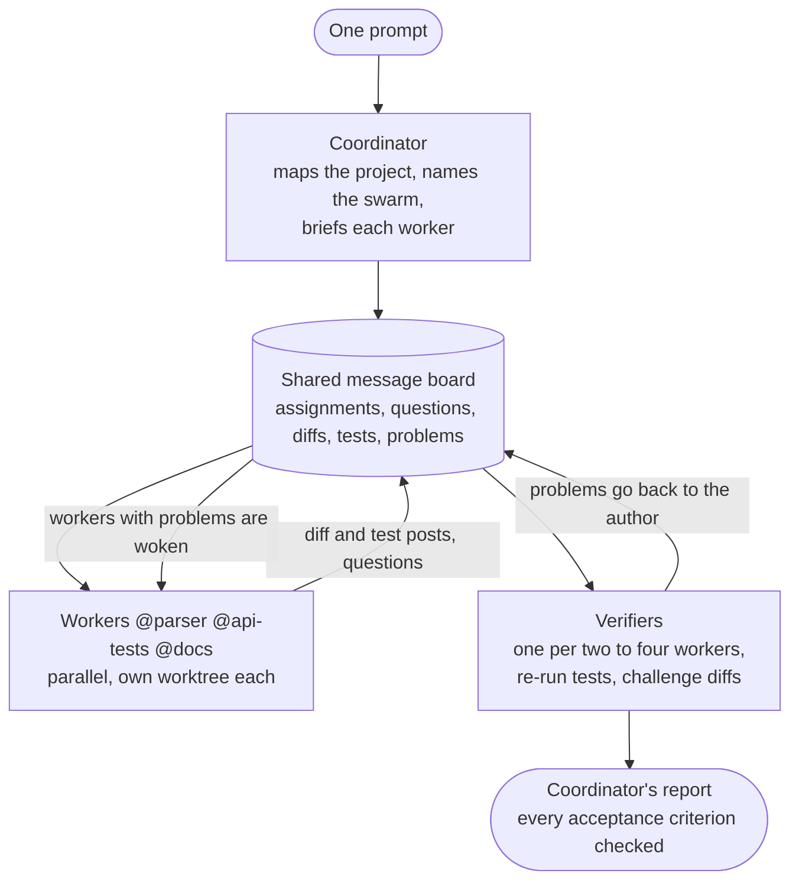

# Hack Dev Code

**An AI agent that works on your computer the way a person does.** It writes and fixes code, runs whole projects with a team of specialist agents, and operates the desktop and the browser: it opens apps, reads windows, clicks, types and checks its own work. It runs on the model you choose: local Ollama models that never leave your machine, DeepSeek, or any OpenAI-compatible provider.

Hack Dev Code ships as a desktop app for Windows and macOS, a Web UI, a command line for Windows, macOS and Linux, a VS Code extension and a GitHub Action for pull-request review. Everything runs on your machine; there is no hosted backend and no account to create.

---

## Contents

1. [What it does](#what-it-does)
2. [Install](#install)
3. [Quick start](#quick-start)
4. [Models and keys](#models-and-keys)
5. [Desktop and browser control](#desktop-and-browser-control)
6. [Multi-agent missions](#multi-agent-missions)
7. [Permissions and safety](#permissions-and-safety)
8. [Customize: skills, connectors, MCP and plugins](#customize-skills-connectors-mcp-and-plugins)
9. [Integrations](#integrations)
10. [Configuration](#configuration)
11. [Architecture](#architecture)
12. [Build from source](#build-from-source)
13. [Known limitations](#known-limitations)
14. [Contributing, license and acknowledgements](#contributing-license-and-acknowledgements)

---

## What it does

| Area | Capability |
|---|---|
| **Coding** | Reads, writes and edits files, runs shell commands (PowerShell or Bash), searches with `glob`, `grep` and a ranked `code_search` over definitions, and keeps a to-do list that it finishes before it reports back. |
| **Missions** | The `hackdev` tool turns one request into a planned project: an analyst, a scout and a planner size a team, specialist builders work in parallel, and three independent gates verify, review (including real screenshots of the UI) and secure the result. |
| **Swarm** | The `hackdev_swarm` tool turns one prompt into a named team: a coordinator briefs each worker, the workers build in parallel and talk only through one shared message board, and adversarial verifiers send problems back to the worker that wrote the code. |
| **Desktop control** | Launches apps by name, lists and reads windows through UI Automation (Windows) or AT-SPI (Linux), acts on numbered controls, reads text with OCR, clicks, drags, scrolls, types and presses shortcuts with real input, across every monitor. |
| **Browser** | A built-in browser pane in the desktop app, plus agent control of Chrome through Chrome DevTools, with a persistent profile so sign-ins stay. |
| **Models** | Local models through Ollama, listed straight from your Ollama install; DeepSeek and any OpenAI-compatible provider through an API key. No account or sign-in. Add several keys per provider and requests rotate through them. |
| **Extensibility** | **Settings → Customize** with built-in and installable skills, OAuth connectors, sign-in to any website, and MCP servers; a plugin marketplace on the Plugins page; custom instructions and `AGENTS.md` files. The agent can delegate to subagents and run workflows. |
| **Undo and resume** | **Undo** on your newest message takes that prompt back: the conversation returns to just before it, the files the agent changed since are put back, and the prompt waits in the message box so you can edit it and send it again. Undo again to go back further; the undone conversation is archived, not deleted. A dropped connection is waited out (about half an hour by default) and the task carries on at the same step, and a stopped or cut-off turn has a **Continue** button. |
| **Everywhere you work** | Desktop app, Web UI, CLI, VS Code extension and a GitHub Action. |

The agent runtime is the upstream DeepSeek Harness: the same agent loop, subagents and workflow engine, with desktop control, local models and the Customize area added on top.

---

## Install

### Desktop app (Windows)

Download the latest installer from the [Releases](https://github.com/raghubirmahato/Hack-Dev-Code/releases) page and run it. It installs for the current user and adds the `hackdev` command to your terminal. The app updates itself from GitHub Releases.

- The installer is not code-signed yet, so Windows SmartScreen may ask you to confirm. Choose **More info → Run anyway**.
- The app asks for administrator rights when it starts, so the agent can install software and operate apps that run as administrator. Decline and it keeps running with normal rights. To never ask, set `HACKDEV_RUN_AS_ADMIN=0` or start it with `--no-admin`.
- If Hack Dev Code is running when you install, update or uninstall, the installer offers to close it for you.

### macOS and Linux

Build the desktop app for macOS, or use the Web UI and CLI on any platform, from source: see [Build from source](#build-from-source).

On Linux, desktop control needs X11 tools:

```sh
sudo apt-get install -y x11-xserver-utils xdotool imagemagick wmctrl xdg-utils xclip tesseract-ocr
```

In a Wayland session it uses ydotool, the compositor's screenshot tool and wl-clipboard instead:

```sh
sudo apt-get install -y ydotool wl-clipboard grim imagemagick tesseract-ocr
sudo systemctl enable --now ydotoold
```

---

## Quick start

1. Open Hack Dev Code (or run `pnpm run start:web` from a source checkout and open the printed address).
2. Choose a workspace folder.
3. Open **Settings → Models** and pick an Ollama model or add a provider's API key. The first model that works becomes the default; change it any time from the model menu in the composer.
4. Ask for something:
   - *"Add a health check endpoint and a test for it."*
   - *"Open Calculator and work out 12 × 7."*
   - *"Install the code-review skill and review my last commit."*
   - *"Use hackdev to build a single-page expense tracker with tests."*
   - *"Use hackdev to build a single-page expense tracker with tests."*

From a terminal:

```sh
hackdev "Fix the failing tests in this repository"
hackdev --profile headless "Review the changes on this branch"
```

---

## Models and keys

- **No preset model.** Nothing is chosen for you: the first model that works becomes the default (DeepSeek only when no other provider has a model), and your own choice in the composer is remembered.
- **DeepSeek.** Paste the key in **Settings → Models**, or set `DEEPSEEK_API_KEY`. There is no DeepSeek account sign-in.
- **Other providers.** Add any OpenAI-compatible endpoint in **Settings → Models**.
- **Local models.** The **Ollama** tab lists every model you have downloaded and adds the one you pick; nothing leaves your machine. Ollama loads models with a 4,096-token context by default, too small for an agent's instructions and tools, so Hack Dev Code creates a `hackdev/<model>` variant with a 32,768-token context (it shares the original's files) and uses that. Pick a model that supports tool calls, such as Qwen 3, Llama 3.1+ or Mistral Nemo; very small models follow instructions less reliably. The list is read from Ollama itself: each model is recorded with its real context length (a model trained for 8K is not treated as 32K), embedding models are left out, models that see images are marked, and a model that cannot call tools is shown as such and left unchecked. Ollama on another port or another machine works too: type its address in the Ollama tab. When a local model writes a tool call into its answer as text (`<tool_call>{...}</tool_call>`, a bare JSON object and similar), Hack Dev Code reads it back as a real tool call instead of stopping.
- **Key pools.** Use **+ Add another key** under a provider's API key (or paste several keys, one per line). Requests rotate through them; a key that is rate limited, out of quota or invalid rests for a minute while the same request continues on the next key, so a conversation never loses its place. Each provider can also list `fallbackModels` for when a model is overloaded on every key.
- **Storage.** Keys are kept in the app's credential store, encrypted at rest with Windows DPAPI on Windows. They are never written to the repository, prompts, logs or reports.

Hack Dev Code is tuned to work well with smaller and free models: tools return text that a model without vision can act on (numbered controls and OCR coordinates instead of guesses), tool groups load on demand to keep requests small, and the agent is reminded to finish open to-do items before it stops.

---

## Desktop and browser control

The desktop tools work on Windows and on Linux with X11 or Wayland; macOS uses its native computer-use provider.

| Tool | Does |
|---|---|
| `desktop_screenshot` | Captures one window, a display, a region or the whole desktop and returns the image with its coordinate mapping. On Windows a window behind others is captured without bringing it forward. Optional OCR. |
| `desktop_window` | Lists windows, including the taskbar and hidden tray icons; reads a window's controls as numbered `[n]` entries with their centre points; focuses, moves, resizes, minimizes or closes; waits for a window or for text to appear. |
| `desktop_element` | Clicks, invokes, toggles, expands, selects, sets values or focuses a control by number, name or automation id (Windows). It waits for a control that has not appeared yet (1.5 seconds by default, `timeout_ms` for slow apps). |
| `desktop_pointer`, `desktop_drag`, `desktop_scroll` | Real mouse input on any monitor, with modifier keys. `press: down|up` holds a button over several steps. |
| `desktop_keys`, `desktop_type` | Key chords and text into the window in front. Long text is pasted through the clipboard, which is restored afterwards. `hold: down|up` keeps a chord pressed. |
| `desktop_ocr` | The text on screen with the centre point of each line. |
| `desktop_sequence` | Up to 30 of these steps in one call, stopping at the first failure. A step marked `optional` (a save prompt or a cookie banner that may not be there) is skipped when it fails. |

Pass `then_read: true` to `desktop_element`, `desktop_keys`, `desktop_type` or a `desktop_pointer` click and the result also says what the window in front shows afterwards, so an action and its check take one call instead of two.

Anything left pressed is released when the tools unload. While the agent is working on the desktop, the screen is kept awake so an idle lock does not interrupt it. Apps running as administrator are reached by running Hack Dev Code as administrator (or through its one-time administrator helper).

**Chrome.** The agent drives Chrome through Chrome DevTools: pages, forms, scripts, screenshots and clicks. To let it use the Chrome you already have open, enable remote debugging at `chrome://inspect/#remote-debugging` and set the `chrome` row to `mode: connect`.

---

## Multi-agent missions

Ask the agent to "use hackdev" for work that deserves a team. The pipeline is fixed in code; the model only supplies the mission text and caps within your limits, so the checks always run.


| Agent | Responsibility |
|---|---|
| Requirements analyst | Turns the mission into requirements and testable acceptance criteria. |
| Codebase scout | Maps the stack, commands, conventions and risks into `.hackdev/PROJECT_MAP.md`. |
| Planner | Sizes the team and returns small tasks with dependencies, owned paths and specialist roles. |
| Specialist builders | One per task (frontend, backend, data, test, docs, security, ...), each in its own git worktree, merged back one at a time. |
| Splitter | Breaks a task a builder could not finish into ordered subtasks. |
| Fact-checker | Confirms listed files exist and re-runs the cheapest decisive evidence. |
| Verifier, Quality + UX, Security | Independent gates with bounded review-fix loops and a regression pass. |
| Integrator | Opens follow-up tasks for unmet criteria. |
| Chronicler | Writes `RUN_REPORT.md` and compacts long-term memory. |

Agents communicate through a typed blackboard (contracts, decisions, facts, risks, warnings, handoffs, questions) rather than free-form chat. While they work, every agent working on one task (the lead, its subagents and theirs) also shares a live **team board** (`team_board`): a post reaches the agents it is addressed to before their next step, so a lead can steer a running subagent, a subagent can ask the agent that started it a question, and a sibling can warn the others the moment it changes an interface. Agents claim the files they are about to edit, and an agent that claims a path someone else holds is told who has it. The board is kept on disk, so a conversation resumed after a restart finds it as it was. Memory persists in `.hackdev/MEMORY.md`, and `.hackdev/PROGRESS.md` lets a rerun plan only the remaining work. Use `hackdev_review` to run only the three gates on work done elsewhere. The full design is in [docs/hack-dev-code.md](docs/hack-dev-code.md), and how Hack Dev Code compares with other coding agents, with the plan from here, is in [docs/roadmap.md](docs/roadmap.md).

The pipeline looks after itself: tasks that would edit the same files are put in order instead of running side by side, the planner gets three attempts at a valid plan, a follow-up wave that makes no progress ends the run instead of repeating, and a wave that changed nothing does not re-run the gates. Each role can run on its own model (`models.planner`, `models.builder`, `models.verifier` on the `tool-hackdev` row), so a strong model plans and audits while a lighter one builds.

It also guards against the ways small models go wrong. Only the agent you talk to can start a mission, so no member starts another one inside it. The planning, checking and reporting roles may write only notes under `.hackdev`: a tool guard refuses their edits to project files and their attempts to hand work to other agents. A member that ends without its structured report is reminded twice before it counts as failed, a report written as text instead of a tool call is still accepted, and lists or yes/no fields it leaves out are filled in as empty. Tool calls written in Gemma's own syntax are read back as real calls, and line numbers copied from a file read into a whole-file write are removed. A rejected plan is fixed by the planner that wrote it, in the same conversation, and isolating a builder in its own git worktree is one helper command.

### Swarm

Ask for a swarm ("use a swarm to ...") when the work splits into pieces that can be built at the same time and you want to follow the team.



| Member | Role |
|---|---|
| Coordinator | Splits the mission, names each worker by its task and gives it a brief: what it owns, what it must not touch and what done means. Answers questions between rounds and writes the final report. It does no technical work itself. |
| Workers | Start with a clean context and their brief. They never message each other privately: everything goes on the board, addressed to `@name`, `@all` or `@coordinator`. |
| Verifiers | One for every two to four workers. They do not fix code: they re-run the tests, try to break the work and send each problem back to the worker that wrote it. A pass needs a passing check. |
| Monitor | Ends a swarm that has gone quiet (the same workers woken again with no file changed) instead of spending the remaining rounds. |

You can name a model for the coordinator, the workers and the verifiers in your prompt, add notes for everyone, and ask for the three gates to review the merged result. The board shows live in the run view while the swarm works, the whole board is written to `.hackdev/swarm/BOARD.md`, and the result card shows the members and the newest posts. A woken worker continues its own conversation and is told only what is new on the board. Every worker is a full agent, so a swarm uses far more model quota than one conversation.

---
## Permissions and safety

Hack Dev Code starts with **Full access**: agents install, edit, delete and run commands without asking. That suits a personal machine. To add limits back:

- choose **Workspace Write** or **Read Only** in the composer;
- set `DSH_PERMISSION_MODE=workspace-write` (or `read-only`) before starting;
- change `defaultPreset` on the `permission` row.

In read-only sessions, installing MCP servers or skills asks for approval. Secrets stay out of code, prompts and reports.

---

## Customize: skills, connectors, MCP and plugins

Open **Settings → Customize**. It has three pages:

- **Skills.** Six skills are built in and need no install: code review, systematic debugging, test-first development, commits and pull requests, security review and web research. Below them is a directory of 32 open-licensed skills from Anthropic's and OpenAI's public skill collections (documents, design, deployment to Vercel, Netlify, Cloudflare and Render, fixing CI, addressing review comments, threat modelling, Playwright, Jupyter, WinUI and more) that you install or remove with one click. A skill you installed by hand is shown and left alone, and a skill of your own with the same name as a built-in one takes its place.
- **Connectors.** Two ways to give the agent an account:
  - **Sign in to any website.** Paste a link (for example `reddit.com`). A browser window opens with its own profile; sign in there and close it. From then on the agent can drive that signed-in browser when a task needs your account. Nothing is needed from the website: no API key, no app registration. Your password is typed by you into the real browser and is never seen or stored by Hack Dev Code; what is kept is the browser profile under `~/.hackdevcode/site-sessions`. The agent records what it learns about a website (which page, which control, what to wait for) in that session's playbook, so the next session does not rediscover it. It asks before it posts, sends, buys or deletes unless you asked for exactly that.
  - **Services with a connector.** 66 services, among them Figma, Notion, Linear, Atlassian, GitLab, ClickUp, Stripe, Vercel, Netlify, Cloudflare, Supabase, Sentry, Datadog, PostHog, Zapier, Dropbox, Miro, Canva and Todoist; each one was checked to accept this app's sign-in (it lets an app register itself, with PKCE). Services that only work with a pre-registered app, such as Slack, Asana and HubSpot, are reached through a website session instead. **Connect** opens the service's sign-in page in your browser; you can also add a connector by its MCP address.
- **MCP servers.** A directory of 67 servers: browsers (Playwright, Chrome DevTools, Browserbase), code and repositories (GitHub, Git, filesystem, Serena, Semgrep, Snyk, ESLint), documentation (Context7, DeepWiki, GitMCP, Microsoft Learn, AWS, Cloudflare, Svelte, Next.js, Angular, Shopify), cloud (AWS, Azure, Google Cloud, Firebase, Kubernetes, Docker, Pulumi), databases (PostgreSQL, MongoDB, Redis, ClickHouse, Elasticsearch, Chroma), search (Brave, Exa, Tavily, Firecrawl, Perplexity, DuckDuckGo, Wikipedia, arXiv), design (Figma, shadcn/ui, Magic UI, Blender) and files (MarkItDown, Excel, Pandoc). A search box at the top of the page narrows whichever list is open. Switch one on, store the keys or folders it needs, or add your own from a command or an address. Keys are stored encrypted and are never shown again.

The **plugin marketplace** is the **Discover** tab of the Plugins page and is on by default. Installing a plugin or skill in a read-only session asks for approval.

---

## Integrations

- **VS Code.** The extension in [`extensions/vscode`](extensions/vscode) runs tasks on your workspace, asks about a selection, reviews your changes and opens the full app inside VS Code.
- **GitHub pull-request review.** The composite action [`.github/actions/hackdev-review`](.github/actions/hackdev-review/action.yml) reviews a pull request in read-only mode and posts the review as a comment:

  ```yaml
  - uses: actions/checkout@v4
    with: { fetch-depth: 0 }
  - uses: ./.github/actions/hackdev-review
    with:
      api-key: ${{ secrets.DEEPSEEK_API_KEY }}
  ```
- **MCP servers.** Turn on GitHub, Playwright, filesystem, Context7 docs, fetch, Git, memory, sequential thinking, time or Brave Search from the built-in directory, or add your own.
- **Skills.** Install skills from a Git repository; they load into every session.
- **Custom instructions.** **Settings → General → Custom instructions**, or `AGENTS.md` files. They are given to the model as its own way of working rather than as a list of rules to consider, so it acts on them at once without weighing, announcing or quoting them. They hold for the whole conversation and for every agent in it, subagents and mission members included; a described role or persona is kept in every reply. Up to 400,000 characters; a short list is repeated before each message and every ten steps of a long task. Where they apply: `~/.hackdevcode/AGENTS.md` for all projects, `AGENTS.md` in a project, `AGENTS.local.md` for private notes.

---

## Configuration

Every setting is documented in [docs/config-catalog.md](docs/config-catalog.md) and every tool in [docs/tool-catalog.md](docs/tool-catalog.md). Bundles choose which plugins run; see [`packages/bundle/base/cordis.patch.yml`](packages/bundle/base/cordis.patch.yml).

---

## Architecture

Hack Dev Code is a TypeScript monorepo built on the Cordis plugin framework: every capability (a tool, a model adapter, a UI panel) is a plugin, and product bundles choose which plugins to mount.

```text
apps/cli, apps/web, apps/desktop     command line, Web UI and Electron desktop shell
packages/core                        agent loop, tools runtime, system prompt
packages/experimental                desktop control (computer use) and browser providers
packages/llm                         model adapters, key pools and fallbacks
packages/mcp, packages/skill         MCP client and directory, skills
packages/customize                   Customize settings area (skills, connectors, MCP servers)
packages/hackdev                     multi-agent mission pipeline and its result card
undefined
packages/bundle                      product bundles (base, web-app, headless)
packages/*                           sessions, sandbox, credentials, file tools, UI and more
extensions/vscode                    VS Code extension
vendor/, native/                     vendored framework libraries, native sandbox helper
docs/                                design doc and generated references
```

---

## Build from source

Requirements: Node.js 24.9 or newer and pnpm 11.

```sh
pnpm install
pnpm run build:artifacts          # outside a git checkout, set DSH_CLIENT_COMMIT_HASH=abcdef1 first
pnpm run start:web                # Web UI at http://127.0.0.1:3080
node apps/cli/lib/bin.js "..."    # CLI
```

Package the desktop app:

```sh
pnpm run package:desktop:win:x64:unsigned     # Windows installer
pnpm run package:desktop:mac:arm64:unsigned   # macOS, Apple silicon
```

Pushing a `v*` tag that matches the desktop version builds the Windows installer and publishes it as a GitHub release.

Checks:

```sh
pnpm run lint
npx tsc -b tsconfig.host.json     # NODE_OPTIONS=--max-old-space-size=8192
npx tsc -b tsconfig.client.json
npx vitest run <path>
```

---

## Known limitations

- Results depend on the model; the agent can be wrong, so review what it changes.
- UAC prompts and the sign-in screen are on Windows' secure desktop, which Windows reserves for the person; no program can answer them, by design. The agent asks you to approve or unlock, and keeps the screen from locking while it works.
- On GNOME and KDE Wayland, only the windows of X11 apps can be listed and moved; Sway and Hyprland expose every window.
- A website session needs Chrome, Edge or Chromium installed. Some websites ask to sign in again after a while or show a verification challenge; the agent then asks you to finish it in the sign-in window. A website's own terms decide whether automated use of your account is allowed.
- In the shared workspace a swarm worker keeps its conversation across rounds. A worker in its own git worktree gets a new folder each round, so it starts afresh there and reads its earlier report and the board instead.
- Undo puts files back only in a git repository; outside one, the conversation is undone but file changes stay. Undo checkpoints are kept in `~/.hackdevcode/checkpoints` and are not pruned. Images and files attached to an undone prompt are not put back in the message box; only its text is.
- Very small local models (around 4B parameters) can run a whole mission, but their plans and code are weak; the pipeline keeps going when one of them fails a step, and the gates catch some mistakes, not all.
- The Windows installer is not code-signed yet.
- Tests of the release tooling that needs PowerShell 7 are skipped, with that reason, on machines without `pwsh`.

---

## Contributing, license and acknowledgements

Conventions for contributors and coding agents are in [AGENTS.md](AGENTS.md). Issues and pull requests are welcome.

[MIT](LICENSE). Third-party dependencies and their licenses are listed in [THIRD_PARTY_NOTICES.md](THIRD_PARTY_NOTICES.md). Hack Dev Code builds on the MIT-licensed DeepSeek Harness agent runtime.
