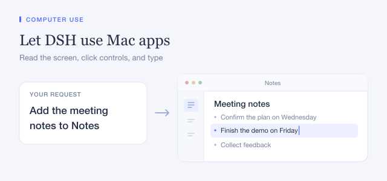

## What agents can do

- **Desktop:** list and launch apps, find windows, read a window's accessibility tree, take screenshots, click, double-click, right-click, drag, type, press keys and shortcuts, scroll, move and resize windows, use menus, and read or write the clipboard.
- **Chrome:** open pages, read them, fill forms, click elements or exact coordinates, upload files, handle dialogs, run page scripts and take screenshots.

Chrome runs with its own persistent profile, so sign-ins you make there stay for later sessions. To let agents drive the Chrome you already use, with its tabs and sign-ins, switch on remote debugging once in `chrome://inspect/#remote-debugging` and set the `chrome` row to `mode: connect`.

## Platforms

Windows and Linux use the built-in Cua Driver. macOS uses the native provider and needs Accessibility and Screen Recording permission, and PTC mode.

## Permissions

Every action goes through the normal tool pipeline, so your permission mode decides what runs without asking. Choose the mode that fits how much you want agents to do on their own.
